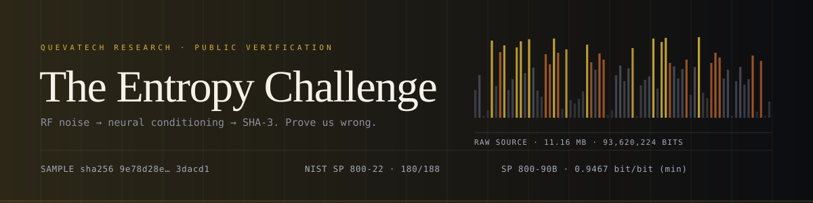
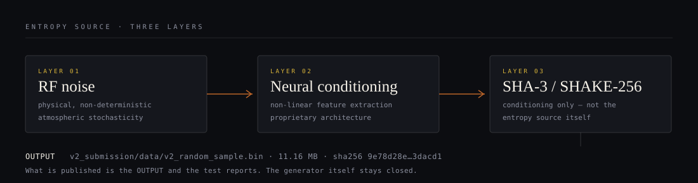

<div align="center">
  
</div>

<p align="center">
  
  
  
  
</p>

<p align="center">
  <b>English</b> · <a href="README.tr.md">Türkçe</a>
</p>

---

## The claim

We built a random number generator that takes **RF noise**, runs it through a
proprietary **neural conditioning stage**, and post-processes the result with
**SHA-3 / SHAKE-256**. We claim the output is indistinguishable from an ideal
random source — that no statistical or learned distinguisher can beat chance on it.

We publish the **output** and the **verification reports**. We do not publish the
generator.

**The ask is one line: prove us wrong.**

## The source in three layers

<div align="center">
  
</div>

| Layer | Component | Role | Published |
| :--- | :--- | :--- | :--- |
| 01 | **RF noise** | Physical, non-deterministic source (atmospheric stochasticity) | ✗ |
| 02 | **Neural conditioning** | Non-linear feature extraction from the raw RF signal | ✗ |
| 03 | **SHA-3 / SHAKE-256** | Cryptographic conditioning and whitening (SP 800-90B style) | ✗ |
| → | **Sample file** | 11.16 MB of output, bit-identical to the certified run | ✓ |

SHA-3 here is used **strictly as a conditioning component, never as the entropy
source**. Conditioning can only reduce entropy; it cannot manufacture it.

## What you are attacking

| Item | Value |
| :--- | :--- |
| Sample | [`v2_submission/data/v2_random_sample.bin`](v2_submission/data/v2_random_sample.bin) |
| Size | 11,702,528 bytes · 93,620,224 bits |
| SHA-256 | `9e78d28edfe7fe1e1a76a3da5eee805c2a472fe43d0abfe873b170a5453dacd1` |
| Certification | [TEST_REPORT.md](TEST_REPORT.md) — SP 800-22, SP 800-90B, Dieharder, AIS 31 |
| Pipeline | [`.github/workflows/nist-tests.yml`](.github/workflows/nist-tests.yml) |

## Headline results

| Metric | Value | Reading |
| :--- | :--- | :--- |
| NIST SP 800-22 (official C STS) | **180 / 188** sub-tests pass | 95.7 %; failures within the expected ~1 % per-test rate |
| SP 800-90B, IID assessment | **H = 7.9675 bits/byte** | IID assumption confirmed |
| SP 800-90B, non-IID (conservative) | **min-entropy 7.5739 bits/byte → 0.9467 bits/bit** | the number we will defend |
| Markov prediction attack | best 50.06 % | indistinguishable from a coin |
| ML distinguisher (GBM, RF) | best 51.25 %, p = 0.36 | no significant advantage |
| Autocorrelation, lags 1–1000 | 2 significant lags (expected ~2.7) | no periodicity |

> **Read the conservative number.** 0.9996 bits/bit is the IID MCV estimate;
> 0.9467 bits/bit is the non-IID bound driven by the t-tuple estimator. A
> conditioned stream *should* look perfect to IID tests — that proves very little.
> The bound we will stand behind is **0.9467 bits/bit**.

## Independent re-check

Not a claim, a command:

```bash
python tools/verify_sample.py
```

| Check | Observed | Gate |
| :--- | :--- | :--- |
| SHA-256 / size | matches the certified report | exact |
| Bit balance | 49.999 % ones, monobit p = 0.847 | p > 0.01 |
| Byte uniformity | χ² = 248.39 (df 255), p = 0.605 | p > 0.01 |
| Byte mean / std | 127.49 / 73.906 | 127.5 / 73.90 |
| Serial correlation, lags 1–8 | max \|ρ\| = 0.00031 | < 0.000877 (3σ) |
| Longest identical run | 28 bits | ≈ log₂(93.6 M) ≈ 26.5 |
| Duplicate 16-byte blocks | 0 of 731,408 | 0 |
| Compression bound | 8.0024 bits/byte | > 7.99 |

All eight gates pass, and the script exits non-zero if any stops passing.
This is deliberately the cheapest possible test set: it is meant to be trivial to
run, not to replace the certification.

## The challenge

Three levels, in increasing order of what a success would prove.

| Level | Question | Acceptance criterion | Recognition |
| :--- | :--- | :--- | :--- |
| 🥇 **L1 · Predictor** | Can you predict bit *N+1*? | Over **N = 100,000** held-out bits: accuracy **≥ 50.52 %** (two-sided p < 0.001). Higher N is allowed; the threshold follows from the binomial test. | Hall of Fame + certificate |
| 🥈 **L2 · Distinguisher** | Can you tell us apart from `os.urandom`? | **≥ 100,000 samples per class**, advantage **> 0.01** at p < 0.001, evaluated on a stream you have never seen. | Hall of Fame, named mention |
| 🥉 **L3 · Pattern finder** | Did every standard test miss something? | A bias or period that survives multiple-comparison correction at p < 1e-6 and reproduces on a second sample. | Hall of Fame, public acknowledgment |

### Protocol — what makes this falsifiable

1. **One sample, one hash.** You attack the file above. Nobody gets a private
   sample; the hash makes substitution visible.
2. **Pre-registration.** Open a PR with your method *before* you see the
   evaluation stream. We release the stream after the method is frozen.
3. **One attempt per level per quarter.** p < 0.001 means one attempt in a
   thousand succeeds by luck; unlimited retries would eventually break any
   generator, including `os.urandom`.
4. **The referee script decides.** `tools/referee.py` runs your frozen method
   against the held-out stream and writes `results.json`. A finding without that
   file is not a finding.
5. **We publish failures too.** Every submission and every referee run is
   recorded in the Hall of Fame, including the ones that prove nothing.

## Hall of Fame

| Date | Researcher | Level | Result | Evidence |
| :--- | :--- | :--- | :--- | :--- |
| — | *your name* | — | — | — |

## Reproduce the certification locally

```bash
pip install -r requirements.txt

# 1. cheapest gate, ~10 s
python tools/verify_sample.py

# 2. NIST SP 800-22 official C implementation (89 streams × 1 Mbit)
git clone --depth=1 https://github.com/arcetri/sts && (cd sts && make legacy)
bash tests/run_sts.sh v2_submission/data/v2_random_sample.bin sts/sts_legacy_fft 89 results/

# 3. NIST SP 800-90B official tools (ea_iid + ea_non_iid)
bash tests/run_ea90b.sh v2_submission/data/v2_random_sample.bin 8 results/

# 4. attack suite: Markov prediction, ML distinguisher, autocorrelation, leakage
python tests/security_tests.py --file v2_submission/data/v2_random_sample.bin
```

## Honest limits

A short list of what this repository **does not** prove. Hiding it would be the
first thing a serious reviewer notices, so it is here instead.

- **Statistical indistinguishability is not physical entropy.** A CSPRNG seeded
  once is statistically perfect and cryptographically worthless. Passing 188
  sub-tests rules out a *class* of defects, not all of them.
- **One sample cannot prove source independence.** A single file cannot
  demonstrate that two devices in the field are uncorrelated. Independent
  captures from different units are the missing evidence.
- **The generator is closed.** You are testing a black box by its output, which
  is exactly the position of every auditor who will ever evaluate it — but it
  also means no one can check for a hidden deterministic seed.
- **Freshness is not tested.** Replay, reseed and start-up behaviour are not
  covered by any test here; NIST SP 800-90B health tests are a separate
  requirement.
- **These results are ours.** The referee run is the only independent evidence,
  and there is none yet. That is what the challenge is for.

## Contact

- Findings and submissions: open a pull request with `submissions/<handle>/`.
- Security-sensitive disclosures: `security@queva.tech` (do not open a public issue).
- Turkish documentation: [README.tr.md](README.tr.md).

---

<p align="center">
  <sub>Sample certified 2026-04 · Documentation CC BY 4.0 · Code MIT · QuevaTech Research</sub>
</p>
