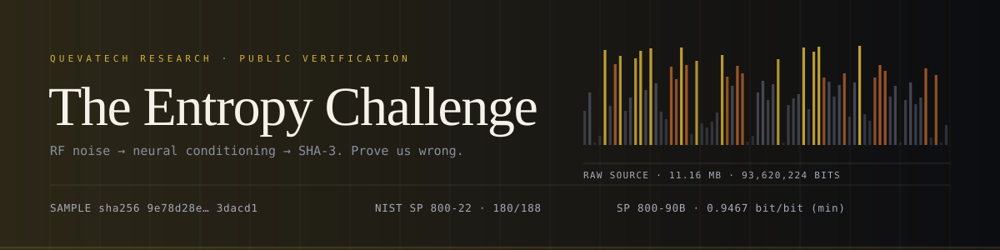
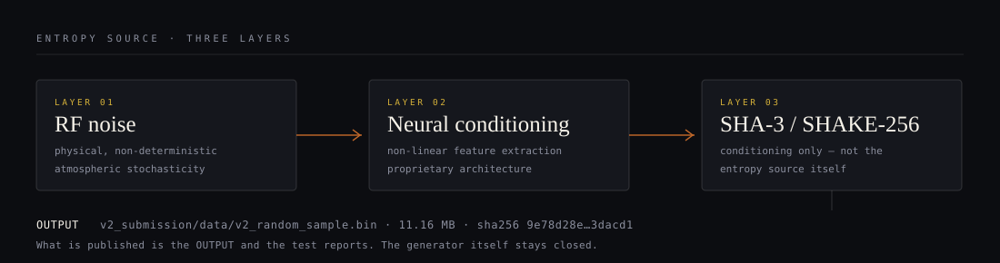

<div align="center">
  
</div>

<p align="center">
  
  
  
  
</p>

<p align="center">
  <a href="README.md">English</a> · <b>Türkçe</b>
</p>

---

## İddia

**RF gürültüsünü** alıp özel bir **sinir ağı koşullandırma katmanından** geçiren ve
çıktıyı **SHA-3 / SHAKE-256** ile işleyen bir rastgele sayı üreteci geliştirdik.
İddiamız şu: çıktı ideal bir rastgele kaynaktan ayırt edilemez — hiçbir istatistiksel
ya da öğrenmeli ayırt edici, şanstan anlamlı biçimde daha iyi performans gösteremez.

**Çıktıyı** ve **doğrulama raporlarını** yayınlıyoruz. Üreteci yayınlamıyoruz.

**Talebimiz tek cümle: yanıldığımızı kanıtlayın.**

## Kaynak üç katmanda

<div align="center">
  
</div>

| Katman | Bileşen | Rol | Yayında mı |
| :--- | :--- | :--- | :--- |
| 01 | **RF gürültüsü** | Fiziksel, deterministik olmayan kaynak (atmosferik stokastisite) | ✗ |
| 02 | **Sinir ağı koşullandırma** | Ham RF sinyalinden doğrusal olmayan özellik çıkarımı | ✗ |
| 03 | **SHA-3 / SHAKE-256** | Kriptografik koşullandırma ve beyazlatma (SP 800-90B tarzı) | ✗ |
| → | **Örnek dosya** | Sertifikalı koşunun birebir çıktısı, 11.16 MB | ✓ |

SHA-3 burada **yalnızca koşullandırma bileşeni** olarak kullanılıyor, entropi kaynağı
olarak değil. Koşullandırma entropiyi yalnızca azaltabilir, üretemez.

## Neyi kırıyorsunuz

| Öğe | Değer |
| :--- | :--- |
| Örnek | [`v2_submission/data/v2_random_sample.bin`](v2_submission/data/v2_random_sample.bin) |
| Boyut | 11.702.528 bayt · 93.620.224 bit |
| SHA-256 | `9e78d28edfe7fe1e1a76a3da5eee805c2a472fe43d0abfe873b170a5453dacd1` |
| Sertifikasyon | [TEST_REPORT.md](TEST_REPORT.md) — SP 800-22, SP 800-90B, Dieharder, AIS 31 |
| Süreç | [`.github/workflows/nist-tests.yml`](.github/workflows/nist-tests.yml) |

## Öne çıkan sonuçlar

| Metrik | Değer | Okuma |
| :--- | :--- | :--- |
| NIST SP 800-22 (resmî C STS) | **180 / 188** alt test | %95,7; hatalar test başına beklenen ~%1 oranında |
| SP 800-90B, IID değerlendirmesi | **H = 7.9675 bit/bayt** | IID varsayımı doğrulandı |
| SP 800-90B, non-IID (konservatif) | **min-entropi 7.5739 bit/bayt → 0.9467 bit/bit** | savunacağımız sayı bu |
| Markov tahmin saldırısı | en iyi %50,06 | yazı-turadan ayırt edilemez |
| ML ayırt edici (GBM, RF) | en iyi %51,25, p = 0,36 | anlamlı avantaj yok |
| Otokorelasyon, gecikme 1–1000 | 2 anlamlı gecikme (beklenen ~2,7) | periyodiklik yok |

> **Konservatif sayıyı okuyun.** 0.9996 bit/bit IID MCV kestirimidir; 0.9467 bit/bit
> ise t-tuple kestiricisinin sürüklediği non-IID alt sınırdır. Koşullandırılmış bir akışın
> IID testlerine kusursuz görünmesi *beklenir* — bu çok az şey kanıtlar. Arkasında
> duracağımız sınır **0.9467 bit/bit**.

## Bağımsız yeniden kontrol

Bir iddia değil, bir komut:

```bash
python tools/verify_sample.py
```

| Kontrol | Gözlenen | Eşik |
| :--- | :--- | :--- |
| SHA-256 / boyut | sertifikalı raporla aynı | birebir |
| Bit dengesi | %49,999 bir, monobit p = 0,847 | p > 0,01 |
| Bayt düzgünlüğü | χ² = 248,39 (df 255), p = 0,605 | p > 0,01 |
| Bayt ortalama / std | 127,49 / 73,906 | 127,5 / 73,90 |
| Seri korelasyon, gecikme 1–8 | max \|ρ\| = 0,00031 | < 0,000877 (3σ) |
| En uzun özdeş koşu | 28 bit | ≈ log₂(93,6 M) ≈ 26,5 |
| Tekrarlayan 16 baytlık blok | 731.408 blokta 0 | 0 |
| Sıkıştırma sınırı | 8,0024 bit/bayt | > 7,99 |

Sekiz eşiğin tamamı geçiyor; herhangi biri geçmezse script sıfırdan farklı kodla çıkar.
Bu set bilinçli olarak mümkün olan en ucuz test: sertifikasyonun yerine geçmek için değil,
tek komutla koşulabilsin diye var.

## Yarışma

Üç seviye; her biri, başarıldığında neyi kanıtlayacağı sırasına göre.

| Seviye | Soru | Kabul ölçütü | Tanınırlık |
| :--- | :--- | :--- | :--- |
| 🥇 **S1 · Kâhin** | *N+1*. biti tahmin edebilir misiniz? | Ayrılmış **N = 100.000** bit üzerinde doğruluk **≥ %50,52** (iki yönlü p < 0,001). Daha büyük N serbest; eşik binom testinden gelir. | Hall of Fame + sertifika |
| 🥈 **S2 · Ayırt edici** | Bizi `os.urandom`'dan ayırabilir misiniz? | **Sınıf başına ≥ 100.000 örnek**, avantaj **> 0,01**, p < 0,001; hiç görmediğiniz bir akışta değerlendirilir. | Hall of Fame, isim anma |
| 🥉 **S3 · Desen avcısı** | Standart testler bir şeyi kaçırdı mı? | Çoklu karşılaştırma düzeltmesinden sonra p < 1e-6 ile ayakta kalan ve ikinci bir örnekte tekrarlanan sapma veya periyot. | Hall of Fame, kamuya açık teşekkür |

### Protokol — bunu yanlışlanabilir kılan şey

1. **Tek örnek, tek hash.** Saldırı yukarıdaki dosyaya yapılır. Kimseye özel örnek
   verilmez; hash, dosyanın değiştirildiğini görünür kılar.
2. **Ön kayıt.** Yönteminizi, değerlendirme akışını görmeden önce PR olarak açın.
   Akış, yöntem donduktan sonra yayınlanır.
3. **Seviye başına çeyrekte tek deneme.** p < 0,001 demek, bin denemeden birinin
   şansla geçmesi demektir; sınırsız deneme `os.urandom` dahil her üreteci eninde
   sonunda kırar.
4. **Hakem scripti karar verir.** `tools/referee.py` dondurulmuş yönteminizi ayrılmış
   akışta koşturur ve `results.json` üretir. Bu dosya olmadan bir bulgu, bulgu değildir.
5. **Başarısızlıkları da yayınlıyoruz.** Her başvuru ve her hakem koşusu Hall of
   Fame'e yazılır; hiçbir şey kanıtlamayanlar dahil.

## Hall of Fame (Onur Listesi)

| Tarih | Araştırmacı | Seviye | Sonuç | Kanıt |
| :--- | :--- | :--- | :--- | :--- |
| — | *sizin adınız* | — | — | — |

## Sertifikasyonu yerelde yeniden üretin

```bash
pip install -r requirements.txt

# 1. en ucuz eşik, ~10 sn
python tools/verify_sample.py

# 2. NIST SP 800-22 resmî C uygulaması (89 akış × 1 Mbit)
git clone --depth=1 https://github.com/arcetri/sts && (cd sts && make legacy)
bash tests/run_sts.sh v2_submission/data/v2_random_sample.bin sts/sts_legacy_fft 89 results/

# 3. NIST SP 800-90B resmî araçları (ea_iid + ea_non_iid)
bash tests/run_ea90b.sh v2_submission/data/v2_random_sample.bin 8 results/

# 4. saldırı seti: Markov tahmini, ML ayırt edici, otokorelasyon, sızıntı
python tests/security_tests.py --file v2_submission/data/v2_random_sample.bin
```

## Dürüst sınırlar

Bu deponun **kanıtlamadığı** şeylerin kısa listesi. Bunu saklamak, ciddi bir
değerlendiricinin ilk fark edeceği şey olurdu; o yüzden burada duruyor.

- **İstatistiksel ayırt edilemezlik, fiziksel entropi değildir.** Bir kez tohumlanan
  CSPRNG istatistiksel olarak kusursuz, kriptografik olarak değersizdir. 188 alt testi
  geçmek bir *kusur sınıfını* eler, hepsini değil.
- **Tek örnek, kaynak bağımsızlığını kanıtlamaz.** Tek dosya, sahada iki cihazın
  ilişkisiz olduğunu gösteremez. Eksik kanıt, farklı birimlerden alınmış bağımsız kayıtlardır.
- **Üreteç kapalı.** Çıktısından bir kara kutuyu test ediyorsunuz; bu, onu denetleyecek
  her denetçinin de konumudur — ama aynı zamanda kimse gizli bir deterministik tohum
  olup olmadığını kontrol edemez.
- **Tazelik test edilmiyor.** Replay, yeniden tohumlama ve açılış davranışı bu testlerin
  kapsamında değil; NIST SP 800-90B sağlık testleri ayrı bir gereklilik.
- **Bu sonuçlar bizim.** Tek bağımsız kanıt hakem koşusudur ve henüz yok. Yarışma tam
  olarak bunun için var.

## İletişim

- Bulgular ve başvurular: `submissions/<kullanıcı>/` altında pull request açın.
- Güvenliğe duyarlı bildirimler: `security@queva.tech` (herkese açık issue açmayın).
- İngilizce dokümantasyon: [README.md](README.md).

---

<p align="center">
  <sub>Örnek sertifikası 2026-04 · Dokümantasyon CC BY 4.0 · Kod MIT · QuevaTech Research</sub>
</p>
